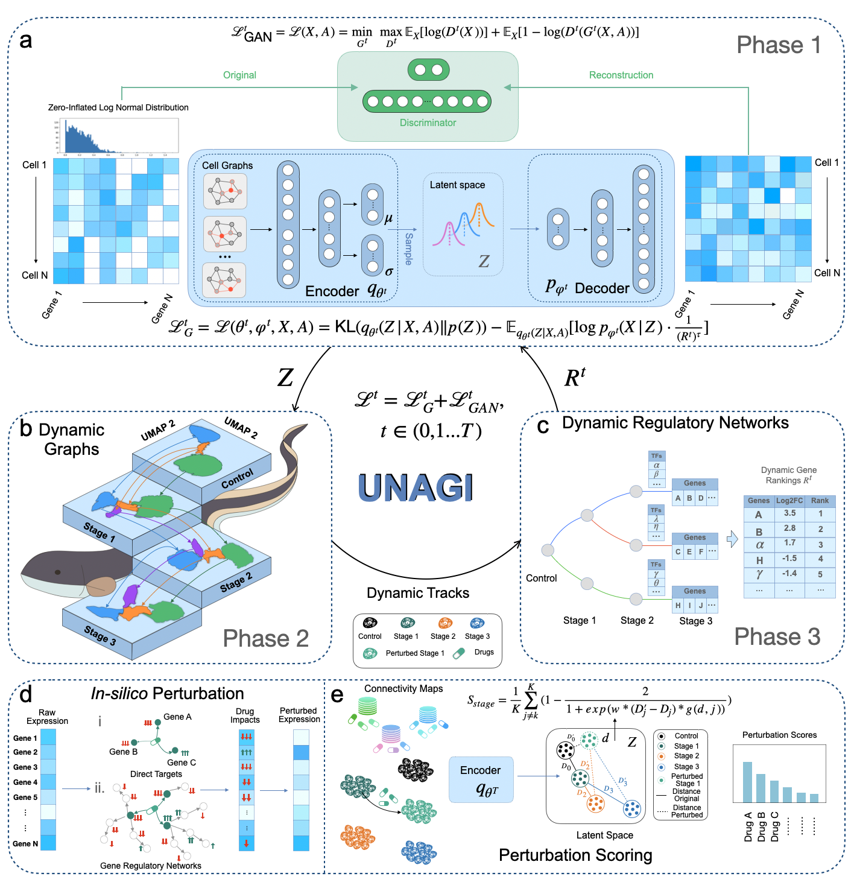

# UNAGI: virtual disease and drug perturbation

UNAGI is a data-driven virtual disease model powered by deep generative AI for reconstructing longitudial cell dynamics in disease progression and performing **unsupervised** in-silico drug perturbations for drug discovery/repurposing.

Full documentations and tutorials can be accessed at [UNAGI-docs](https://unagi-docs.readthedocs.io/en/latest/index.html).

## Citation
Zheng, Y., Schupp, J.C., Adams, T. et al. A deep generative model for deciphering cellular dynamics and in silico drug discovery in complex diseases. Nat. Biomed. Eng (2025). https://doi.org/10.1038/s41551-025-01423-7

## Highlights
* UNAGI supports both time-series scRNA data and control/disease (two-condition) data.
* UNAGI can construct temporal cell dynamics
    * trajectories
    * TFs
    * temporal marker genes
* UNAGI can perform **UNSUPERVISED** perturbation for
    * single gene
    * gene combinations
    * pathways
    * drug and compounds

## News
* Sept/2025: We are honored to have this work highlighted by Anaconda AI Platform! ([link](https://www.anaconda.com/resources/case-study/mcgill-university))
* June/2025: We are thrilled to share that UNAGI is published on Nature Biomedical Engineering! ([link](https://www.nature.com/articles/s41551-025-01423-7))

## Overview 

<!-- UNAGI is a comprehensive unsupervised in-silico cellular dynamics and drug discovery framework. UNAGI adeptly deciphers cellular dynamics from human disease time-series single-cell data and facilitates in-silico drug perturbations to earmark therapeutic targets and drugs potentially active against complex human diseases. All outputs, from cellular dynamics to drug perturbations, are rendered in an interactive visual format within the UNAGI framework. Nestled within a deep learning architecture Variational Autoencoder-Generative adversarial network (VAE-GAN), UNAGI is tailored to manage diverse data distributions frequently arising post-normalization. It also innovatively employs disease-informed cell embeddings, harnessing crucial gene markers derived from the disease dataset. On achieving cell embeddings, UNAGI fabricates a graph that chronologically links cell clusters across disease stages, subsequently deducing the gene regulatory network orchestrating these connections. UNAGI is primed to leverage time-series data, enabling a precise portrayal of cellular dynamics and a superior capture of disease markers and regulators. Lastly, the deep generative prowess of the UNAGI framework powers an in-silico drug perturbation module, simulating drug impacts by manipulating the latent space informed by real drug perturbation data from the CMAP database. This allows for an empirical assessment of drug efficacy based on cellular shifts towards healthier states following drug treatment. The in-silico perturbation module can similarly be utilized to investigate therapeutic pathways, employing an approach akin to the one used in drug perturbation analysis. -->

-   Learning disease-specific cell embeddings through iterative training processes.

-   Constructing temporal dynamic graphs from time-series single-cell data and reconstructing temporal gene regulatory networks to decipher cellular dynamics.

-   Identifying dynamic and hierarchical static markers to profile cellular dynamics, both longitudinally and at specific time points.

-   Performing *in-silico* perturbations to identify potential therapeutic pathways and drug/compound candidates.

## Installation

Create and activate a Python environment before running UNAGI. A conda environment is the most common setup, but a venv works too.
```
conda create -n unagi python=3.10
conda activate unagi
```

UNAGI installation

### Option 1: Install from pip

```
pip install scUNAGI
```

This installs the Python package and CLI. The repo-local YAML templates, tutorials, and workflow skill are not part of the standalone pip install.

### Option 2: Install from Github (Recommended)

Installing UNAGI directly from GitHub ensures you have the latest version. **(Please install directly from GitHub to use the provided Jupyter notebooks for tutorials and walkthrough examples.)**

```
git clone https://github.com/mcgilldinglab/UNAGI.git
cd UNAGI
pip install .
```

The repository checkout includes a bundled `idrem/` directory. When you run UNAGI from the cloned repo, UNAGI will prefer that bundled iDREM runtime automatically.

### Local skill install

The Codex/Claude workflow skill lives in `skills/unagi-workflow-orchestrator/`. If you want to install it separately in a local skill workspace, clone the UNAGI repository and point your skill installer at that directory. The skill expects the cloned UNAGI repo to remain available locally, but it can be installed independently from the repo checkout.

### Agent-friendly workflow (new)

Run a full training workflow with a YAML config from the repo checkout:

```bash
unagi preflight -c configs/unagi_workflow_template.yaml
unagi run -c configs/unagi_workflow_template.yaml
```

The preflight step validates paths/keys and normalizes stage files to canonical `0.h5ad..N-1.h5ad` layout before training.

See `configs/unagi_workflow_template.yaml` for a complete template.

### Skill-first workflow

Use the repo-local skill:

- Skill spec: `skills/unagi-workflow-orchestrator/SKILL.md`
- Job orchestration script: `skills/unagi-workflow-orchestrator/scripts/unagi_job.py`
- Accessibility evaluator report: `skills/unagi-workflow-orchestrator/reports/accessibility_report.md`

Example:

```bash
python skills/unagi-workflow-orchestrator/scripts/unagi_job.py submit \
  --repo-root /path/to/UNAGI \
  --job-name demo-skill-run
```

### Prerequisites
-   Python >=3.9 
-   pyro-ppl>=1.8.6
-   scanpy>=1.9.5
-   **anndata==0.8.0** 
-   torch >= 2.0.0
-   matplotlib>=3.7.1

**Required files**

Preprocessed CMAP database ([Link](https://zenodo.org/records/15692608)) provides drug-gene pairs data to run UNAGI drug perturbation function.
-    Option 1 : 'cmap_drug_target.npy' uses the direct drug target genes provided in CMAP LINCS 2020.
-    Option 2: 'cmap_drug_treated_res_cutoff.npy' uses genes that are up/down-regulated significantly after individual drug treatments in CMAP LINCS 2020. We kept the top 5% drug-gene pairs based on level 5 MODZ score.
-    'cmap_direction_df.npy' indicates the direction of gene regulated by drugs after treatments. The drug regulation direction of gene is based on level 5 MODZ score.
-    Use your own drug-target pairs, please see [this tutorial](https://github.com/mcgilldinglab/UNAGI/blob/main/tutorials/Customize_drug_database_for_perturbation.ipynb).

Preprocessed IPF snRNA-seq dataset: [One Drive](https://mcgill-my.sharepoint.com/:f:/g/personal/yumin_zheng_mail_mcgill_ca/EhUPO3Ip0IhCh0kz-Uply_MBzksNoX9N6HDEgC_dUHbCkg?e=biVLuV)
-    UNAGI outcomes to reproduce the figures and tables generated for the manuscript.

Example dataset: [Link.](https://github.com/mcgilldinglab/UNAGI/tree/main/UNAGI/data/example)
-   The dataset for UNAGI walkthrough demonstration. 

**iDREM runtime:**

The GitHub repo includes a bundled `idrem/` directory, and UNAGI will use it automatically when running from the cloned repo.

If you want to use a different iDREM copy, override it with:
- `run.idrem_dir` in your workflow YAML
- or `UNAGI_IDREM_DIR` in your shell environment

If you install only the standalone pip package instead of using the cloned repo, you should provide your own iDREM directory through one of those override paths.

**iDREM prerequisites:**

-   Java
    To use iDREM, a version of Java 1.7 (64-bit) or later **must be installed**. If Java (64-bit) 1.7 or later is not currently installed, please refer to http://www.java.com for installation instructions.

-   JavaScript
    To enable the interactive visualization powered by Javascript.
    (The users are still able to run the software off-line, but Internet access is needed to view the result interactively.)

## Tutorials:

### Dataset preparation

[Prepare datasets to run UNAGI.](https://github.com/mcgilldinglab/UNAGI/blob/main/tutorials/dataset_preparation.ipynb)

### Training and analysis on an example dataset

[UNAGI training and analysis on an example dataset.](https://github.com/mcgilldinglab/UNAGI/blob/main/tutorials/run_UNAGI_using_example_dataset.ipynb)

### Visualize the results of the UNAGI method

[Visualization on an example dataset.](https://github.com/mcgilldinglab/UNAGI/blob/main/tutorials/visualize_UNAGI_results_example_dataset.ipynb)

### Using UNAGI with a customized pathway or drug database for in-silico perturbation

Run UNAGI on [Customized drug/compound database](https://github.com/mcgilldinglab/UNAGI/blob/main/tutorials/Customize_drug_database_for_perturbation.ipynb) and [Customized pathway database.](https://github.com/mcgilldinglab/UNAGI/blob/main/tutorials/Customize_pathway_database_for_perturbation.ipynb)

### Predicting post-treatment gene expressions

[Predict the post-treatment gene expression changes using the PCLS data.](https://github.com/mcgilldinglab/UNAGI/blob/main/tutorials/PCLS_data_post_treatment_prediction.ipynb)

### Walkthrough Example

[From loading data to downstream analysis.](https://github.com/mcgilldinglab/UNAGI/blob/main/docs/notebooks/examples/walkthrough_example.ipynb)

Please visit [UNAGI-docs](https://unagi-docs.readthedocs.io/en/latest/index.html) for more examples and tutorials.

## Contact
[Yumin Zheng](mailto:yumin.zheng@mail.mcgill.ca), [Naftali Kaminski](mailto:naftali.kaminski@yale.edu), [Jun Ding](mailto:jun.ding@mcgill.ca)
